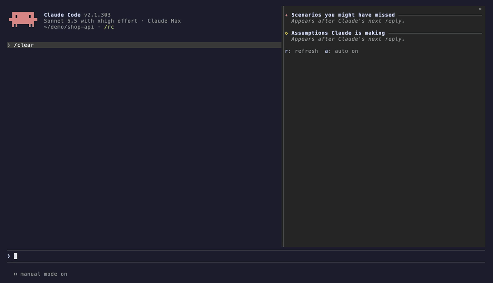

# Blind spots

**See what Claude decided without asking you, rated by risk, right next to your conversation.**



When you ask Claude Code to build something, it quietly fills in the blanks. It decides who can see what, what gets deleted and what happens when something fails. Usually you only find out later.

After every reply, Blind spots scans the conversation and shows:

- **Check this first.** The one decision that would hurt most if it's wrong, with what breaks, like "Old invoices are deleted, not archived. If this is wrong: customer history is gone for good."
- **Claude decided for you.** The other decisions Claude made on its own. Dots show what a wrong guess would cost, from ●○○○○ (a small fix) to ●●●●● (serious harm).
- **Questions you haven't raised yet.** The few questions that would change what gets built.

Press a number and that item's question goes into your prompt box, ready to edit, add to or send. Nothing is sent until you press Enter. If a decision is fine, say so with one key. That costs nothing and it's never raised again.

## Install

Add the marketplace and install the plugin, then start a new session.

```sh
claude plugin marketplace add aadityasp/blind-spots
claude plugin install blind-spots@blind-spots
```

You can also clone it straight into your skills folder.

```sh
git clone https://github.com/aadityasp/blind-spots ~/.claude/skills/blind-spots
```

The pane opens by itself at the start of every session. To try it for a single session without installing it, point Claude Code at the folder instead.

```sh
claude --plugin-dir /path/to/blind-spots
```

Built and tested on Claude Code 2.1.303. It needs a version that supports mods.

### On a machine you didn't set up

On a borrowed laptop, a cloud dev box or an interview environment, check what you have first.

```sh
claude --version
```

- **It prints a version.** Run the two install commands above, then start a new session with `claude`. The pane opens by itself. Blind spots uses whichever model that session runs on, with nothing to configure, and the pane's first line says which model it is reading with. If `plugin install` isn't available on that version, clone the repo and run `claude --plugin-dir ./blind-spots`.
- **`claude` isn't found, or the assistant is built into a web page.** The mod can't run there. Paste [PROMPT.md](PROMPT.md) into that assistant's chat instead. It asks for the same three lists, in plain text.

Mods need Claude Code itself. They don't run in other AI tools.

## Use

| Key | What it does |
| --- | --- |
| `1` to `9` | Add that item's question to your prompt |
| `It's right` | Mark the top risk as fine. No message is sent |
| `f` | Mark the rest fine. No message is sent |
| `u` | Bring back everything you marked fine, and check again |
| `r` | Check again now |
| `a` | Turn the check after every reply on or off |
| `d` | Show more (6 decisions, 4 questions) or fewer (3 and 2) |
| `/blind-spots` | Reopen the pane and check again |

Hotkeys work while the pane has focus. Click it or press `ctrl+x` then `tab` to focus it. Items you've added to your prompt end in "(added)", and items that appeared since the last check end in "(new)".

Hover over any item to see the exact sentence it will add. On Claude Code 2.1.327 or later the top risk also sits in its own card. On older versions the pane shows the same items and controls without those touches.

The pane docks beside the conversation in fullscreen mode and sits above the prompt otherwise. Claude Code only opens a pane by itself on a terminal at least 144 columns wide. On a narrower one, run `/blind-spots` once, and from then on it opens by itself from 110 columns.

## How it works

After each of Claude's replies in the main conversation, the mod forks the conversation once in the background and asks for both lists as JSON, with a 1 to 5 risk for every decision. The fork runs on the session's own model. If the answer comes back wrapped in prose, it asks once more for the JSON alone before showing an error. Turns run by subagents don't trigger a scan.

Each request includes what's on screen and what you've marked fine. Items that still hold keep their exact wording, so only real changes stand out, and anything you settled never comes back. Only the newest scan can write to the pane, so a slow request never overwrites a newer one.

## What it reads and sends

The background fork reads your conversation, the same context Claude already has, and returns only the two lists. Nothing goes anywhere else.

Pressing an item puts its one-sentence question, which the fork wrote, such as "Should the pane really refresh after every reply?", into your prompt box after anything you've already typed. You edit it and send it yourself. The one exception is a session with no prompt box at all, where there's nowhere to put a draft: there, pressing an item sends the sentence as your next message, marked "(asked)". The mod never sends anything on its own. The full [privacy policy](PRIVACY.md) has the details.

## Hooks

| Hook | What it does |
| --- | --- |
| `session.start` | Opens the pane and registers `/blind-spots` |
| `command.run` | Answers `/blind-spots` by opening the pane and refreshing it. It handles no other command. |
| `turn.complete` | Passes the finished turn through unchanged, then schedules a refresh after main conversation replies |
| `ui.render` | Draws the pane |

## Cost

Every scan is one extra model call over your conversation. It reuses the conversation's prompt cache and asks for a quick answer with no deliberation, so most of what it reads is billed at the cache rate. Marking items fine is free. To scan only when you choose, press `a` to turn the automatic scan off and press `r` when you want one.

## Development

```sh
claude plugin test .
claude plugin validate .
```

Everything lives in `hooks/register.tsx`. The pane's state is typed in `types/index.d.ts`, and the tests are in `tests/`. Claude Code generates the typings in `.claude-plugin/types/` for editor type checking, and git ignores them.

## License

[MIT](LICENSE)
