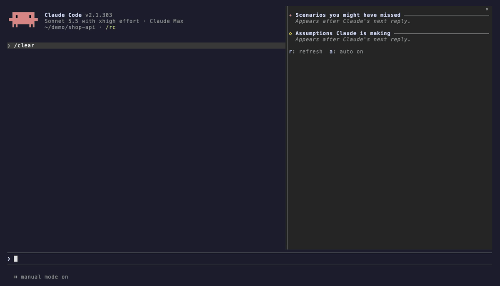

# Blind spots

**See what Claude assumed and what you forgot to ask, right next to your conversation.**



When you ask Claude Code to build something, it quietly fills in the blanks. It decides how people sign in, which database to use and what happens when something fails. Usually you only find out later.

Blind spots adds a side pane that lists those blanks after every reply.

- **Assumptions Claude is making.** Decisions it made without asking you, like "Users sign in with email, not SSO."
- **Scenarios you might have missed.** Edge cases and questions worth a look, like "What happens when an upload fails?"

Press any item and it goes to Claude as your next message. Correcting an assumption or digging into a scenario takes one key.

## Install

Add the marketplace and install the plugin, then start a new session.

```sh
claude plugin marketplace add aadityasp/blind-spots
claude plugin install blind-spots@blind-spots
```

You can also clone it straight into your skills folder.

```sh
git clone https://github.com/aadityasp/blind-spots ~/.claude/skills/blind-spots
```

The pane opens by itself at the start of every session. To try it for a single session without installing it, point Claude Code at the folder instead.

```sh
claude --plugin-dir /path/to/blind-spots
```

Built and tested on Claude Code 2.1.303. It needs a version that supports mods.

## Use

| Key | What it does |
| --- | --- |
| `1` to `6` | Ask Claude about that scenario |
| Click or Tab and Enter on an assumption | Confirm or correct it |
| `r` | Refresh now |
| `a` | Turn auto refresh on or off |
| `/blind-spots` | Reopen the pane and refresh it |

Hotkeys work while the pane has focus. Click it or press `ctrl+x` then `tab` to focus it. Items you've already asked about turn dim and get a ✓.

The pane docks beside the conversation in fullscreen mode and sits above the prompt otherwise. Claude Code only opens a pane by itself on a terminal at least 144 columns wide. On a narrower one, run `/blind-spots` once, and from then on it opens by itself from 110 columns.

## How it works

After each of Claude's replies in the main conversation, the mod forks the conversation once in the background and asks for both lists as JSON. Turns run by subagents don't trigger a refresh.

Each request includes the lists currently on screen. That lets assumptions you've confirmed or corrected drop off, while scenarios that still matter stay put. Only the newest refresh can write to the pane, so a slow request never overwrites a newer one.

## What it reads and sends

The background fork reads your conversation, the same context Claude already has, and returns only the two lists. Nothing goes anywhere else.

The mod submits a prompt only when you press an item, and it never submits anything on its own. What it submits is the one-sentence message shown for that item, which the fork wrote, such as "Should the pane really refresh after every reply?" It goes into the conversation as your next message, exactly as if you had typed it. The full [privacy policy](PRIVACY.md) has the details.

## Hooks

| Hook | What it does |
| --- | --- |
| `session.start` | Opens the pane and registers `/blind-spots` |
| `command.run` | Answers `/blind-spots` by opening the pane and refreshing it. It handles no other command. |
| `turn.complete` | Passes the finished turn through unchanged, then schedules a refresh after main conversation replies |
| `ui.render` | Draws the pane |

## Cost

Every refresh is one extra model call that reads your conversation, so it adds to your token usage. If that matters, press `a` to turn auto refresh off and press `r` whenever you want a fresh read.

## Development

```sh
claude plugin test .
claude plugin validate .
```

Everything lives in `hooks/register.tsx`. The pane's state is typed in `types/index.d.ts`, and the tests are in `tests/`. Claude Code generates the typings in `.claude-plugin/types/` for editor type checking, and git ignores them.

## License

[MIT](LICENSE)
