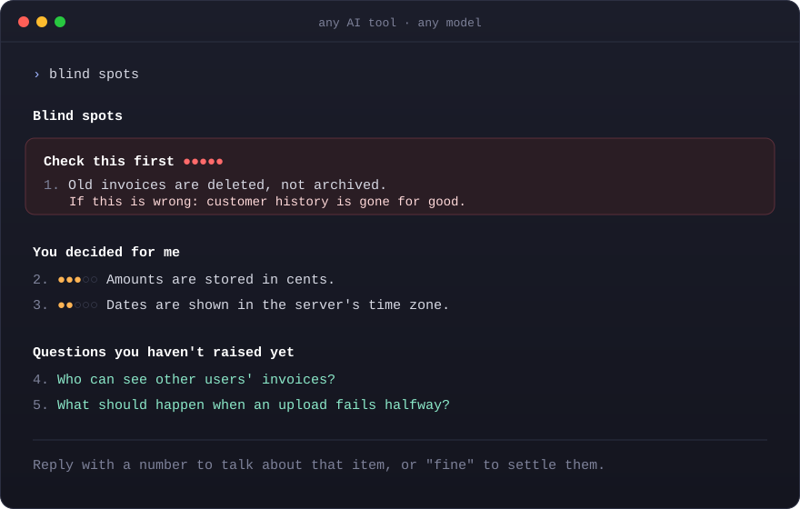

<h1 align="center">Blind spots</h1>

<p align="center">
  <b>See what your AI assistant decided without asking you, rated by risk.</b>
</p>

<p align="center">
  <a href="https://github.com/aadityasp/blind-spots/tags"></a>
  <a href="LICENSE"></a>
  <a href="#install"></a>
  <a href="#which-model-it-uses"></a>
</p>

<p align="center">
  
</p>

<p align="center">
  <code>npx skills add aadityasp/blind-spots -g -a '*' -y</code>
</p>

<p align="center">
  Claude Code · Codex · Cursor · Copilot · Gemini CLI · Antigravity · Windsurf · Cline · Amp · Goose · Kiro · Zed · and more
</p>

---

When you ask an AI to build something, it quietly fills in the blanks. It decides who can see what, what gets deleted and what happens when something fails. Usually you only find out later.

Blind spots shows you three things:

| Part | What it shows |
| --- | --- |
| 🔴 **Check this first** | The one decision that would hurt most if it's wrong, and what breaks. |
| 🟠 **Decided for you** | The other choices the AI made on its own. Dots show what a wrong guess would cost, from ●○○○○ (cosmetic) to ●●●●● (lost data, money or trust). |
| 🟢 **Questions you haven't raised yet** | The few questions that would change what gets built. |

Reply with a number to talk about an item, or "fine" to settle them so they never come back.

It works with any model, in about 20 AI tools. In Claude Code it's a live side pane that updates after every reply. Everywhere else it's a skill: say **"blind spots"** for a check, or **"blind spots on"** to get one after every reply.

## Install

### Any tool, one command

This installs the skill into every AI tool it finds on your machine: Codex, Cursor, Copilot, Gemini CLI, Antigravity, Windsurf, Cline, Kilo, opencode, Amp, Goose, Qwen, Zed, Junie, Kiro, Warp, Augment, Grok Build and more. It needs Node 22.20 or later.

```sh
npx skills add aadityasp/blind-spots -g -a '*' -y
```

Leave out `-a '*' -y` to choose the tools yourself, or leave out `-g` to install into the current project only. With the GitHub CLI 2.90 or later, `gh skill install aadityasp/blind-spots` does the same.

### Your tool's own installer

| Tool | Command | What you get |
| --- | --- | --- |
| Claude Code | `claude plugin marketplace add aadityasp/blind-spots` then `claude plugin install blind-spots@blind-spots` | The live pane, plus the skill |
| Gemini CLI | `gemini extensions install https://github.com/aadityasp/blind-spots` | The skill, plus `/blind-spots` |
| Qwen Code | `qwen extensions install https://github.com/aadityasp/blind-spots` | The skill, plus `/blind-spots` |
| Google Antigravity | `agy plugin install https://github.com/aadityasp/blind-spots` | The skill, as `/blind-spots` |
| GitHub Copilot CLI | `copilot plugin install aadityasp/blind-spots` | The skill |
| Codex | `codex plugin marketplace add aadityasp/blind-spots`, then install it from `/plugins` | The skill, as `$blind-spots` |
| Amp | `amp skill add aadityasp/blind-spots --global` | The skill |
| Devin CLI | `devin plugins install aadityasp/blind-spots` | The skill |
| Hermes Agent | `hermes plugins install aadityasp/blind-spots --enable` | The skill |
| Pi | `pi install git:github.com/aadityasp/blind-spots` | The skill |
| Kimi Code | `/plugins install https://github.com/aadityasp/blind-spots` | The skill |
| Cursor | Customize, then **From GitHub Repository**, then paste the repo URL | The skill |
| Kiro | **Import power from a repository URL**, then paste the repo URL | The skill |
| Zed | Command palette: **agent: create skill from url** | The skill |
| Muse | `git clone https://github.com/aadityasp/blind-spots` then `muse plugins install ./blind-spots` | The skill |

Start a new session after installing. Tools not listed here, such as Windsurf, Cline, Goose, Warp, Junie and Augment, get it from the one-command install above.

### A chat where nothing can be installed

Paste [PROMPT.md](PROMPT.md) into the chat. It's the same skill as plain text.

### Which model it uses

None of its own. The check runs on whatever model your tool is already using, so there's nothing to configure and no extra key. In Claude Code the pane's first line names the model.

## Use in any tool

| Say | What happens |
| --- | --- |
| `blind spots` or `/blind-spots` | A check now |
| `blind spots on` | A short check at the end of every reply that changes code, config, data or a plan |
| `blind spots off` | Stop checking after every reply |
| a number, like `2` | Talk about that item |
| `fine` | Settle the items shown, so they're never raised again |

In Codex the command is `$blind-spots`. Tools also load the skill by themselves when you ask "what did you assume?" or "what am I missing?".

## Use in Claude Code

The pane opens by itself at the start of every session. To try it for one session without installing, run `claude --plugin-dir /path/to/blind-spots`. It needs a Claude Code version with mods; it was built and tested on 2.1.303 and 2.1.327.


| Key | What it does |
| --- | --- |
| `1` to `9` | Add that item's question to your prompt |
| `It's right` | Mark the top risk as fine. No message is sent |
| `f` | Mark the rest fine. No message is sent |
| `u` | Bring back everything you marked fine, and check again |
| `r` | Check again now |
| `a` | Turn the check after every reply on or off |
| `d` | Show more (6 decisions, 4 questions) or fewer (3 and 2) |
| `/blind-spots` | Reopen the pane and check again |

Hotkeys work while the pane has focus. Click it or press `ctrl+x` then `tab` to focus it. Items you've added to your prompt end in "(added)", and items that appeared since the last check end in "(new)".

Hover over any item to see the exact sentence it will add. On Claude Code 2.1.327 or later the top risk also sits in its own card. On older versions the pane shows the same items and controls without those touches.

The pane docks beside the conversation in fullscreen mode and sits above the prompt otherwise. Claude Code only opens a pane by itself on a terminal at least 144 columns wide. On a narrower one, run `/blind-spots` once, and from then on it opens by itself from 110 columns.

## How it works

After each of Claude's replies in the main conversation, the mod forks the conversation once in the background and asks for both lists as JSON, with a 1 to 5 risk for every decision. The fork runs on the session's own model. If the answer comes back wrapped in prose, it asks once more for the JSON alone before showing an error. Turns run by subagents don't trigger a scan.

Each request includes what's on screen and what you've marked fine. Items that still hold keep their exact wording, so only real changes stand out, and anything you settled never comes back. Only the newest scan can write to the pane, so a slow request never overwrites a newer one.

## What it reads and sends

The background fork reads your conversation, the same context Claude already has, and returns only the two lists. Nothing goes anywhere else.

Pressing an item puts its one-sentence question, which the fork wrote, such as "Should the pane really refresh after every reply?", into your prompt box after anything you've already typed. You edit it and send it yourself. The one exception is a session with no prompt box at all, where there's nowhere to put a draft: there, pressing an item sends the sentence as your next message, marked "(asked)". The mod never sends anything on its own. The full [privacy policy](PRIVACY.md) has the details.

## Hooks

| Hook | What it does |
| --- | --- |
| `session.start` | Opens the pane and registers `/blind-spots` |
| `command.run` | Answers `/blind-spots` by opening the pane and refreshing it. It handles no other command. |
| `turn.complete` | Passes the finished turn through unchanged, then schedules a refresh after main conversation replies |
| `ui.render` | Draws the pane |

## Cost

In other tools the check is part of the assistant's own reply, so it costs only the few hundred extra words it writes. "Blind spots on" adds that to each reply that changes something.

In Claude Code every scan is one extra model call over your conversation. It reuses the conversation's prompt cache and asks for a quick answer with no deliberation, so most of what it reads is billed at the cache rate. Marking items fine is free. To scan only when you choose, press `a` to turn the automatic scan off and press `r` when you want one.

## Development

```sh
node scripts/build.mjs --check
claude plugin test .
claude plugin validate .
```

The review itself lives in `skills/blind-spots/SKILL.md`. Every tool's manifest, `PROMPT.md` and the Gemini command are generated from it and from the version in `scripts/build.mjs`: edit those two, then run `node scripts/build.mjs`. Never edit a generated file by hand. `--check` fails if any of them is out of date.

The Claude Code pane lives in `hooks/register.tsx`. The pane's state is typed in `types/index.d.ts`, and the tests are in `tests/`. Claude Code generates the typings in `.claude-plugin/types/` for editor type checking, and git ignores them.

## License

[MIT](LICENSE)
